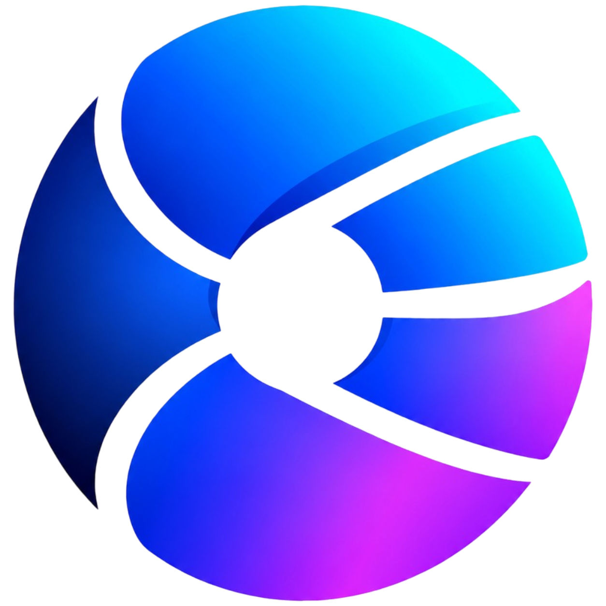

<div align="center">



# LenChat

**Drop your code. Ask your AI. Build with freedom.**

A free, open-source, developer-first AI workspace. Bring your own API keys, drop a whole project into the page, and talk to any model, with everything staying in your browser.

<br>

[](LICENSE)
[](CHANGELOG.md)
[](#-installation--setup-guide)
[](#-privacy--local-first-architecture)
[](#-supported-ai-providers)

<a href="https://ko-fi.com/B5I529BI8K" target="_blank"></a>

<br>


<sub>LenChat main workspace.</sub>

</div>

<br>

## Quick Navigation

| | | |
|---|---|---|
| [🚀 Quick Start](#-quick-start) | [✨ Key Features](#-key-features) | [🤖 Supported AI Providers](#-supported-ai-providers) |
| [📖 Installation & Setup Guide](#-installation--setup-guide) | [🛠️ Technology Stack](#%EF%B8%8F-technology-stack) | [📁 Project Structure](#-project-structure) |
| [🔒 Privacy & Local-First Architecture](#-privacy--local-first-architecture) | [📜 Licensing & Attribution](#-licensing--attribution) | [💖 Support & Donate](#-support--donate) |

<br>

## Why LenChat

Most AI chat tools make you choose: pay a subscription, hand your code to someone else's server, or fight with a heavy self-hosted stack. LenChat takes a different route. It follows a **Bring Your Own Key (BYOK)** model: you plug in your own API keys for the providers you already use, pay them directly, and keep full control of cost and data. Add several keys per provider and swap between them from the **+** menu when one hits its limit. Choose how much history each message carries, and delete any message to stop paying for it.

It is built for people who work with real projects. Drag in a **ZIP**, a **whole folder**, or a handful of files and LenChat reads them **in your browser**, builds a directory tree, and attaches the result to your next prompt. The architecture is **local-first**: keys, history, snippets and files live in your browser's storage. There is no database, no Node.js and no build step. If your host can run PHP, it can run LenChat, from a laptop to a free shared hosting account.

<br>

## 🚀 Quick Start

```bash
git clone https://github.com/lenny-tishay/LenChat.git
cd LenChat
php -S 127.0.0.1:8000
```

Then open **http://127.0.0.1:8000**, click **Settings**, add an API key for any provider, and drop a project onto the page.

> [!TIP]
> No PHP on your machine yet? Expand **Prerequisites** in the [setup guide](#-installation--setup-guide) for one-line installs on Windows, macOS and Linux.

<br>

## ✨ Key Features

<table>
<tr>
<td width="50%" valign="top">

**🤖 Multi-provider AI engine**
OpenAI, Anthropic, Gemini, Groq, DeepSeek, OpenRouter, local Ollama and any OpenAI-style endpoint, all from one interface.

</td>
<td width="50%" valign="top">

**📦 Project context & codebase analysis**
Drop ZIPs, folders or many files at once. Get a directory tree and file-by-file context attached to your prompt.

</td>
</tr>
<tr>
<td valign="top">

**📄 Document extraction & OCR**
Read PDF, DOCX and XLSX in the browser. Images are sent to vision models, or read with OCR for text-only models.

</td>
<td valign="top">

**🖼️ Live web & UI sandbox**
HTML, CSS, JS and SVG from the AI render live in a sandboxed iframe. Edit the code and watch it update.

</td>
</tr>
<tr>
<td valign="top">

**🎙️ Interactive voice workspace**
Dictation, read-aloud replies and a hands-free conversation mode that listens, sends, speaks and listens again.

</td>
<td valign="top">

**🗂️ Workspace management**
Export and import sessions and settings, keep a snippet library, tag and search history, switch light and dark themes.

</td>
</tr>
</table>

<br>

<details>
<summary><b>Multi-Provider AI Engine</b></summary>

<br>

- One chat window, many providers. Switch provider, key and model from the chip in the top bar.
- **Multiple labelled keys per provider.** Rotate to a fresh key from the **+** menu the moment one is rate-limited.
- **Your own models.** Use preset model lists or type any model ID, and point a custom endpoint at any OpenAI-compatible API.
- **Per-chat cost control.** Send the prompt and files only, the whole conversation, or just the last N messages. Turn off the system prompt on each message to save tokens.
- **Max output tokens and temperature** are one setting away.
- **Errors stay in the UI.** Provider errors are shown to you and never fed back to the model.
- **Transport options.** Call providers directly from the browser, or route through the optional PHP relay.

</details>

<details>
<summary><b>Project Context & Codebase Analysis</b></summary>

<br>

- Drag files, folders or a ZIP anywhere on the page, or use the **+** menu. You can paste screenshots too.
- Everything is parsed client-side into clean markdown context blocks and shown in an **attachment tray** with chips for each file.
- **Show tree** displays the project structure so you can see exactly what the AI will receive. Select all, select none, or remove single files before you send.
- Choose how long attached files stay in context ("Keep files for last N messages") so you are not paying to resend a codebase on every turn.

</details>

<details>
<summary><b>Document Extraction & OCR</b></summary>

<br>

- Read **PDF**, **DOCX** and **XLSX** files in the browser.
- **Image handling is your call:** always send the picture to vision models, always read it with OCR, or let LenChat choose from the model you picked.
- Generate pictures with `/imagine ...`, using Pollinations (free, no key) or your OpenAI key.

</details>

<details>
<summary><b>Live Web & UI Sandbox Preview</b></summary>

<br>

- Ask for HTML, CSS, JS or SVG and get a **live preview** rendered in a sandboxed iframe.
- Open the clickable, editable **code canvas**, copy with syntax awareness, and download generated files.
- **Fix with AI.** If a preview throws an error, LenChat can offer a one-click fix, or retry automatically (up to 2 tries).
- **File Generation Skill.** The AI delivers multi-file output with one download button per generated file.

</details>

<details>
<summary><b>Interactive Voice Workspace</b></summary>

<br>

- **Dictation (STT)** with the browser's Web Speech engine or a transcription endpoint you configure.
- **Voice commands while dictating:** say "send it", "clear the text", "stop listening" or "new chat".
- **Read aloud (TTS)** with browser voices or ElevenLabs. Tune voice, speed and pitch, or read every finished reply automatically.
- **Hands-free conversation:** send after a pause, read the reply, then listen again.

</details>

<details>
<summary><b>Workspace Management</b></summary>

<br>

- **Local history** with tags and instant search, plus a **snippet library** for code you reuse.
- **Export and import** sessions and configuration. API keys are only included if you tick the option.
- **Prompt starters** and examples that you can edit in Settings.
- **Light and dark themes**, with a mobile-first layout built for touch.
- **Update checker.** Compare with GitHub from Settings and update with a re-upload, or enable one-click auto-update on your own server.

</details>

<br>

<div align="center">

<br>
<sub>Screenshot placeholder: landscape capture of the attachment tray with the project tree open.</sub>
<br><br>

<br>
<sub>Screenshot placeholder: landscape capture of a live HTML preview beside the code canvas.</sub>
</div>

<br>

## 🤖 Supported AI Providers

| Provider | Notes |
|---|---|
| **OpenAI** | Chat, vision, and image generation with your own key |
| **Anthropic (Claude)** | Direct API support |
| **Google Gemini** | Chat and vision models |
| **Groq** | Fast open-model inference |
| **DeepSeek** | Chat and reasoning models |
| **OpenRouter** | One key for hundreds of hosted models |
| **Ollama (local)** | Run models on your own machine, no key needed |
| **Custom endpoint** | Any OpenAI-style API, with your own model IDs |

> [!NOTE]
> You pay each provider directly. LenChat never marks up or intercepts your usage.

<br>

## 📖 Installation & Setup Guide

Open the section that matches your setup.

<details>
<summary><b>Prerequisites</b></summary>

<br>

| Requirement | Details |
|---|---|
| **PHP 7.4 or newer** | Runs the entry page and the optional streaming relay |
| **cURL extension** | Needed only if you use the server relay |
| **A modern browser** | Chrome, Edge, Firefox or Safari (voice features depend on browser support) |

Check your PHP version and extensions:

```bash
php -v
php -m | grep -i curl
```

</details>

<details>
<summary><b>Terminal Setup (Windows, macOS, Linux, WSL)</b></summary>

<br>

**Windows PowerShell**

```powershell
winget install PHP.PHP
git clone https://github.com/lenny-tishay/LenChat.git
cd LenChat
php -S 127.0.0.1:8000
```

**Windows CMD**

```bat
git clone https://github.com/lenny-tishay/LenChat.git
cd LenChat
php -S 127.0.0.1:8000
```

**Git Bash**

```bash
git clone https://github.com/lenny-tishay/LenChat.git
cd LenChat
php -S 127.0.0.1:8000
```

**macOS** (with [Homebrew](https://brew.sh))

```bash
brew install php
git clone https://github.com/lenny-tishay/LenChat.git
cd LenChat
php -S 127.0.0.1:8000
```

**Linux** (Debian / Ubuntu)

```bash
sudo apt update && sudo apt install php-cli php-curl git
git clone https://github.com/lenny-tishay/LenChat.git
cd LenChat
php -S 127.0.0.1:8000
```

**WSL**

Use the Linux commands above inside your WSL distribution, then open `http://127.0.0.1:8000` in your Windows browser.

</details>

<details>
<summary><b>Step-by-Step Server Setup</b></summary>

<br>

1. **Clone the repository**

   ```bash
   git clone https://github.com/lenny-tishay/LenChat.git
   ```

2. **Enter the project folder**

   ```bash
   cd LenChat
   ```

3. **Start the built-in PHP server**

   ```bash
   php -S 127.0.0.1:8000
   ```

4. **Open the app** at [http://127.0.0.1:8000](http://127.0.0.1:8000)

5. **Add a key.** Open **Settings**, choose a provider, paste your API key and save.

</details>

<details>
<summary><b>Deploy to shared hosting (cPanel, InfinityFree and similar)</b></summary>

<br>

LenChat needs no database and no build step, so deployment is a file upload.

1. Download the repository as a ZIP.
2. Upload and extract it into `public_html` (or a subfolder) with your host's file manager or FTP.
3. Visit your domain. That is all.

Server options, such as the relay, update checker and security headers, live in `config.php`. Keep your relay access token private if you enable the relay on a public site.

</details>

<details>
<summary><b>Troubleshooting</b></summary>

<br>

| Problem | Fix |
|---|---|
| `php: command not found` | PHP is not installed or not on your `PATH`. Install it (see Terminal Setup), then reopen your terminal. |
| `Failed to listen on 127.0.0.1:8000` (port in use) | Choose another port: `php -S 127.0.0.1:8080` |
| `Call to undefined function curl_init()` | Enable the cURL extension: `sudo apt install php-curl` on Linux, or uncomment `extension=curl` in `php.ini` on Windows and macOS. |
| Provider request fails from the browser | Some providers block direct browser calls. Switch **Transport** to the server relay in Settings. |
| Microphone does not work | Browsers allow voice input only on `localhost` or HTTPS. Use `127.0.0.1` / `localhost` locally and HTTPS in production. |

</details>

<br>

## 📁 Project Structure

```text
LenChat/
├── index.php          # App shell and client configuration
├── config.php         # Providers, defaults, relay, security and update settings
├── preview.php        # Sandboxed live-preview host
├── api/
│   ├── stream.php     # Optional streaming relay (SSE)
│   └── update.php     # GitHub update checker / updater
├── assets/
│   ├── css/style.css  # Custom design system, no framework
│   └── js/            # Vanilla ES6+ modules (storage, reader, provider, engine, app...)
├── remote/            # Remote configuration and branding
├── CHANGELOG.md       # Release notes
├── UPDATING.md        # How to update an existing install
├── NOTICE.md          # Attribution requirements (AGPL Section 7)
└── LICENSE            # GNU AGPL-3.0
```

<br>

## 🛠️ Technology Stack

| Layer | Technology | Role |
|---|---|---|
| **Server** | PHP 7.4+ | App shell, configuration and an optional cURL server relay |
| **Front end** | HTML5, CSS3, vanilla JavaScript | Responsive UI and SSE streaming with zero heavy framework dependencies |
| **Storage** | Browser LocalStorage | Client-side keys, state and session management |
| **File processing** | In-browser parsers | PDF, DOCX and XLSX extraction, plus OCR for images |

No Node.js. No database. No build pipeline.

<br>

## 🔒 Privacy & Local-First Architecture

- **Your keys stay in your browser.** They are stored locally and sent only to the provider you choose, directly or through your own relay.
- **Files are read client-side.** ZIPs, folders, PDFs and images are parsed in the page before anything is sent.
- **No accounts, no tracking, no database.** History, tags and snippets live in your browser, and you can export or erase them any time from Settings.
- **Sandboxed previews.** Generated HTML runs in a sandboxed iframe, isolated from the app itself.
- **Strict by default.** The app ships with a Content Security Policy, `X-Frame-Options`, `nosniff` and a no-referrer policy.
- **Optional relay, your server.** If you use the PHP relay, it runs on your own host and can be protected with an access token.

> [!IMPORTANT]
> Prompts and attached content are sent to the AI provider you select, under that provider's terms. Pick Ollama to keep everything on your own machine.

<br>

## 📜 Licensing & Attribution

LenChat is released under the **GNU Affero General Public License v3.0 (AGPL-3.0)** with **additional attribution requirements under Section 7**. Please read [`LICENSE`](LICENSE) and [`NOTICE.md`](NOTICE.md) before redistributing or hosting a modified version. In short: you are free to use, study, modify and share LenChat, you must keep the required attribution, and modified versions served over a network must offer their source.

**Need to build it into a closed-source product?** A **commercial license** without AGPL obligations is available from LENTECH DIGIWORKS: [lentech.co.ke/lenchat-enterprise](https://lentech.co.ke/lenchat-enterprise)

Copyright (c) 2026 Leonard Muia t/a LENTECH DIGIWORKS.

<br>

## 💖 Support & Donate

LenChat is built and maintained by **Leonard Muia** and is free for everyone. If it saves you time or money, you can help it keep growing:

| | |
|---|---|
| **Ko-fi** | <a href="https://ko-fi.com/B5I529BI8K" target="_blank"></a> |
| **PayPal** | `leonardlentech@gmail.com` |
| **More ways to give** | [leonard.lentech.co.ke/donate](https://leonard.lentech.co.ke/donate) |

Starring the repository, sharing it, and opening well-written issues all help too.

<br>

<div align="center">

**[LENTECH DIGIWORKS](https://lentech.co.ke)** &nbsp;|&nbsp; **[Personal Portfolio](https://leonard.lentech.co.ke)**

<sub>Open source project by LENTECH DIGIWORKS &middot; Drop your code. Ask your AI. Build with freedom.</sub>

</div>
